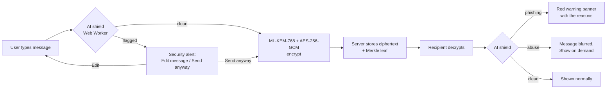
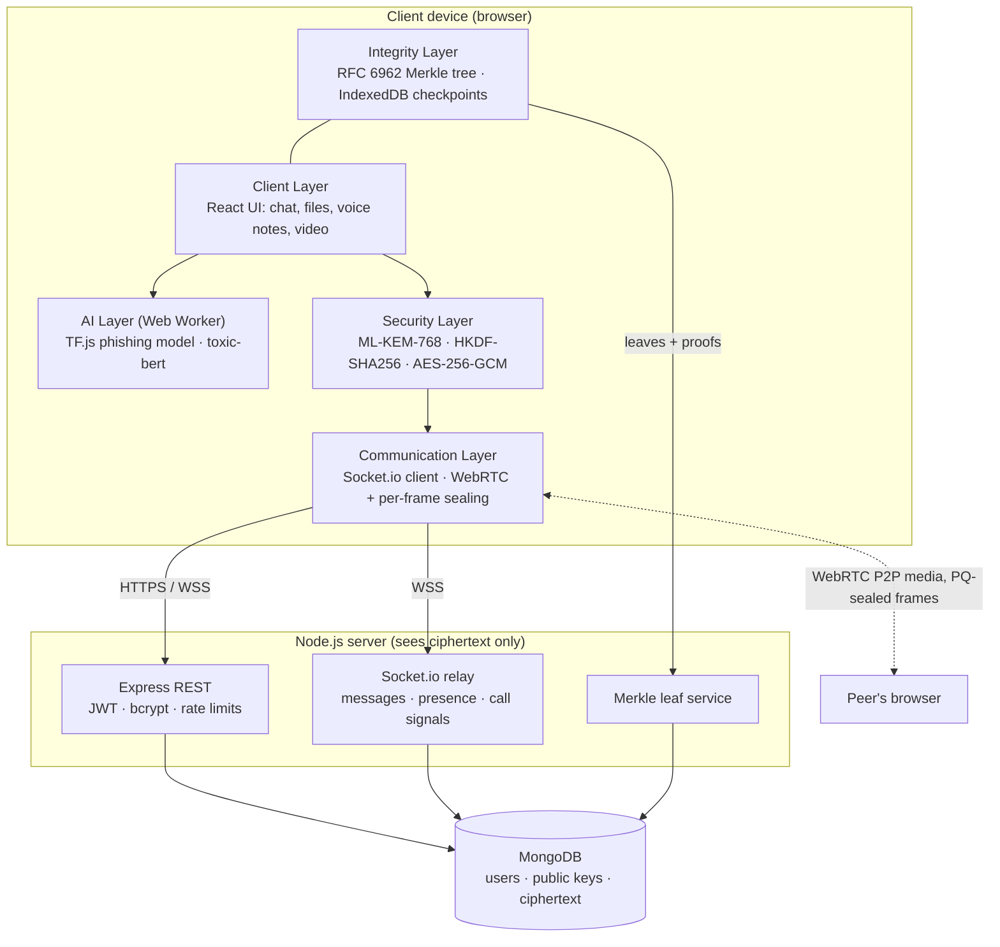
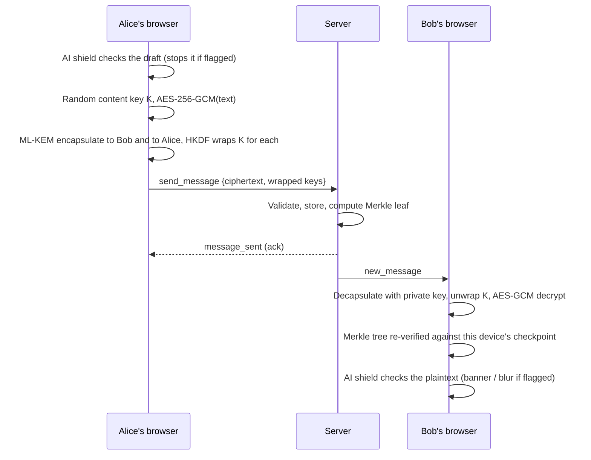
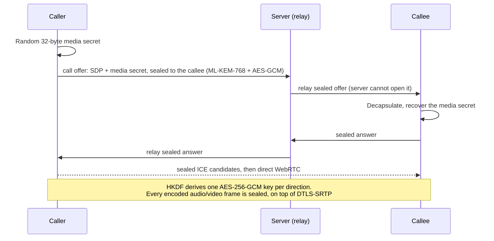

# Q-Chat: A Post-Quantum Secure Messaging Platform

> Major project, Dept. of AI & DS, Siddaganga Institute of Technology, Tumakuru — 2025-26.
> This README is written to track the claims made in the Phase-I report, so each
> objective, architecture layer and requirement below carries its **actual**
> implementation status rather than an aspirational one.

Q-Chat is an end-to-end encrypted messaging platform built to resist the
"harvest now, decrypt later" threat: an adversary who records encrypted traffic today
and waits for a quantum computer to open it. Key exchange uses **ML-KEM-768**
(NIST FIPS 203), message encryption uses **AES-256-GCM**, and the server is designed
so that it holds only ciphertext it cannot open.

---

## Contents

1. [Objectives and status](#1-objectives-and-status)
2. [In-depth cryptographic pipeline](#2-in-depth-cryptographic-pipeline-the-core)
3. [Real-time network and synchronization](#3-real-time-network--synchronization-logic)
4. [Merkle-tree transcript integrity](#4-merkle-tree-transcript-integrity)
5. [Secure real-time communication (WebRTC)](#5-secure-real-time-communication-webrtc-video-calling)
6. [On-device AI shield](#6-on-device-ai-shield-objective-3)
7. [Performance and scalability](#7-performance-and-scalability-objective-5-report-table-52)
8. [Messaging features](#8-messaging-features-attachments-replies-reactions-delete-presence)
9. [Identity, contacts and access control](#9-identity-contacts--access-control)
10. [System architecture, modules and requirements](#10-system-architecture-modules-and-requirements)
11. [Threat model — what this does and does not protect](#11-threat-model--what-this-does-and-does-not-protect)
12. [Setup and installation](#12-setup--installation)
13. [Current limitations and future scope](#13-current-limitations-and-future-scope)
14. [Repository layout](#14-repository-layout)
---

## 1. Objectives and Status

The five objectives from Chapter 1.2 of the report, mapped to the delivered system.

| # | Objective | Status |
|---|---|---|
| 1 | Hybrid encryption framework combining **ML-KEM** with **AES-256** for secure key exchange and message confidentiality | ✅ **Delivered.** ML-KEM-768 encapsulation per recipient, AES-256-GCM over the content, HKDF-SHA256 key derivation. Payload v2 encrypts once and wraps the content key per party — a measured **49.9%** reduction in stored bytes over the naive approach. |
| 2 | Data integrity through a **Merkle hash chain**, detecting unauthorized modification of chat history | ✅ **Delivered.** Every conversation is an RFC 6962 **Merkle tree**: each message is a leaf hashed from its sender, id, timestamp and ciphertext, and the root is shown in the chat header. Each device checkpoints the tree and, on every visit, names any message that was **modified, removed or back-dated** since — including a rewritten timestamp, which encryption alone cannot detect. Any message can be proven a member of the history with a ⌈log₂ n⌉-hash **inclusion proof**, and the two participants can compare roots in one click. |
| 3 | On-device **AI phishing detection**, preserving privacy by keeping analysis local | ✅ **Delivered.** Two models run in a browser Web Worker: a TensorFlow.js phishing classifier trained for this project (93.8% precision, 4.3% false alarms on 7,402 held-out samples, 0.5 ms per message) and the Transformers.js `toxic-bert` hate-speech model. Outgoing drafts are checked *before encryption* and stopped with an explanation; incoming phishing is bannered and abuse blurred. No text ever leaves the device (§6). |
| 4 | Secure real-time **WebRTC** video calling with post-quantum protection of **signaling and media** | ✅ **Delivered, and extended.** Signaling is ML-KEM sealed, and *every encoded media frame* is additionally sealed with AES-256-GCM under an ML-KEM-derived key — so the audio and video are protected by post-quantum cryptography, not only by WebRTC's classical DTLS-SRTP. Verified in live two-party calls. |
| 5 | **Scalable and modular architecture** supporting future enhancement | ✅ **Delivered and measured.** Clean layer and module separation (§10), env-driven configuration, stateless JWT auth, room-based socket fan-out and cursor-paged history. Load-tested: **250 concurrent users, 5,000 messages, 0 lost, 3.7 ms median delivery** on a single process; at 500 users still 0 lost, with latency rising as that one process saturates (§7). |

**All five objectives are delivered**, including the full post-quantum media path
that the report lists only as a target, a Merkle tree with inclusion proofs, and on-device
AI detection with measured accuracy. Section 13 lists what remains future scope.

---

## 2. In-Depth Cryptographic Pipeline (The Core)

All cryptography runs client-side. The design is **hybrid**: a post-quantum KEM agrees a
key, and a fast symmetric cipher does the bulk work. The Node.js server never receives a
plaintext message, a content key, or an unencrypted private key.

Why hybrid rather than "encrypt with ML-KEM"? A KEM does not encrypt a message of your
choosing — it *encapsulates*, producing a random shared secret plus a ciphertext that
recovers it. So ML-KEM establishes the key and AES-256-GCM encrypts the content. That split
is also why the key-derivation step matters: everything downstream depends on turning a
32-byte KEM output into a proper symmetric key (§2.5).

### 2.1 The Theory & Algorithms of ML-KEM-768
RSA and ECC rest on integer factorisation and discrete logarithms, both of which Shor's
algorithm solves in polynomial time on a sufficiently large quantum computer. ML-KEM rests
on a different problem: **Module Learning With Errors (M-LWE)** over the polynomial ring
$R_q = \mathbb{Z}_q[X]/(X^{256} + 1)$ with modulus $q = 3329$. Recovering the secret means
finding short vectors in a high-dimensional lattice, and no efficient quantum algorithm is
known for that.

**Stated precisely:** ML-KEM is *believed* to resist quantum attack because no quantum
algorithm is known that breaks M-LWE efficiently. It is not *proven* immune — such a proof
would require complexity-theoretic results nobody has. That belief is why NIST standardised
it as FIPS 203 in 2024. Claiming certainty here would be wrong, and it is the kind of claim
a reviewer checks first.

This project uses **ML-KEM-768** ($k=3$), the parameter set NIST places at roughly AES-192
equivalent security — the middle of the three, chosen over ML-KEM-512 for margin and over
ML-KEM-1024 for key and ciphertext size, which matters when every message carries an
encapsulation.

#### Core Formulas:
1. **Key Generation:**
   - Sample a 32-byte public seed $\rho$ and expand it into the matrix
     $A \in R_q^{3 \times 3}$, so $A$ never has to be transmitted.
   - Sample a small secret vector $s \in R_q^3$ and error vector $e \in R_q^3$.
   - **Public key relation:** $t = A s + e$
   - *Public key $= (\rho, t)$; secret key $= s$.*

   Transmitting $\rho$ rather than $A$ is why the public key is **1184 bytes**:
   $3 \times 384$ bytes for the three compressed polynomials of $t$, plus the 32-byte
   seed. Sending $A$ itself would cost several kilobytes.

2. **Encapsulation** (sender produces ciphertext $c$ and shared secret $SS$):
   - Sample a random message $m$ and a small vector $r \in R_q^3$, plus error terms
     $e_1 \in R_q^3$ and $e_2 \in R_q$.
   - $u = A^T r + e_1$
   - $v = t^T r + e_2 + \text{Encode}(m)$
   - *Ciphertext $c = (\text{Compress}(u), \text{Compress}(v))$ — **1088 bytes** after
     compression — and $SS = \text{KDF}(m, H(c))$.*

3. **Decapsulation** (recipient recovers $SS$):
   - Apply the secret key: $v - s^T u = \big(t^T r + e_2 + \text{Encode}(m)\big) - s^T\big(A^T r + e_1\big) \approx \text{Encode}(m)$.
   - The error terms stay small enough to vanish in the rounding, so $m$ decodes
     exactly, and re-running the KDF yields the same 32-byte $SS$.

> The shared secret is derived from $m$ rather than being encoded directly, and the
> recipient re-encrypts $m$ to check the ciphertext was honestly formed. That is the
> Fujisaki–Okamoto transform, and it is what upgrades the scheme from CPA to CCA
> security — the property that matters when an attacker can submit chosen ciphertexts.

### 2.2 Code Implementation: Keypair Generation & Vaulting
*File: `frontend/src/components/Register.jsx`*
When a user registers or logs into a new device, the browser triggers generation directly in RAM:

```javascript
import { ml_kem768 } from '@noble/post-quantum/ml-kem.js';

// 1. Generate Lattices
const keys = ml_kem768.keygen();

// 2. Vault Private Key strictly in local storage, keyed by user id
const b64Priv = b64encode(keys.secretKey);
localStorage.setItem(`qchat_priv_${data.user.id}`, b64Priv);

// 3. Transmit 1184-byte Public Key to Server
const b64Pub = b64encode(keys.publicKey);
await axios.post('/api/auth/register', { username, password, publicKey: b64Pub });
```
**Storage Specifications:**
*   **Public Key:** Exactly **1184 bytes**. Stored in MongoDB.
*   **Private/Secret Key:** Exactly **2400 bytes**. Held in `localStorage` in the clear,
    and additionally stored server-side **encrypted under the account password** so it can
    be recovered on another device (Section 3.1). The plaintext key never leaves the browser.

### 2.3 Code Implementation: Encrypting the Transmission (v1, historical)
*File: `frontend/src/crypto/encryption.js`*

> This is the **original v1** writer, kept here because it is the simplest
> illustration of KEM + DEM. Nothing sends v1 any more, so `encryptMessage` has
> been removed from the code; current messages use the v2 envelope in §2.5.
> `decryptMessage` (§2.4) is still in the code so stored v1 history keeps opening.

When Alice sends "Hello" to Bob, Bob's 1184-byte Public Key is fetched to encapsulate a secret. Because KEM systems encrypt data incredibly slowly, QChat implements a Key Derivation Function (KDF) into a fast, symmetric AES-256 cipher.

```javascript
export async function encryptMessage(text, recipientPublicKey) {
  if (!text) throw new Error('EMPTY_MESSAGE');
  if (!recipientPublicKey || recipientPublicKey.byteLength !== 1184) {
    throw new Error(`INVALID_PUBLIC_KEY: expected 1184 bytes, got ${recipientPublicKey?.byteLength}`);
  }

  try {
    // 1. ML-KEM Encapsulation (Generates 1088-byte lattice ciphertext & 32-byte secret)
    const { sharedSecret, cipherText: encapsulatedKey } = ml_kem768.encapsulate(recipientPublicKey);

    // 2. Key Derivation (Hash lattice secret to raw AES symmetric key)
    const aesKey = await deriveAESKey(sharedSecret);

    // 3. AES-256-GCM Symmetric Fast-Encryption
    const iv = crypto.getRandomValues(new Uint8Array(12));
    const encodedData = new TextEncoder().encode(text);

    const encryptedBuffer = await crypto.subtle.encrypt(
      { name: 'AES-GCM', iv },
      aesKey,
      encodedData
    );

    // Buffer automatically contains [Ciphertext... + 16-byte AuthTag MAC]
    const encryptedArray = new Uint8Array(encryptedBuffer);
    const ciphertext = encryptedArray.slice(0, -16);
    const authTag = encryptedArray.slice(-16);

    // 4. Return as JSON mapping logic (also used verbatim for attachments/WebRTC signaling)
    return {
      encapsulatedKey: b64encode(encapsulatedKey),
      nonce: b64encode(iv),
      ciphertext: b64encode(ciphertext),
      authTag: b64encode(authTag),
      timestamp: Date.now()
    };
  } catch (error) {
    throw new Error('ENCRYPTION_FAILED');
  }
}
```
In the current code the same role is played by `encryptForRecipients` (§2.5), and `text`
is not limited to chat text: attachments (base64 images, audio and files), reactions and
WebRTC signaling (`JSON.stringify`'d SDP/ICE data) all go through it. See Sections 5 and 6.

The 16-byte `authTag` is a MAC (Message Authentication Code). If the server tries to flip a single bit of the ciphertext stream, the Native Web Crypto subsystem instantly invalidates decoding to prevent tamper attacks.

### 2.4 Code Implementation: Decrypting the Transmission
When Bob's socket receives the payload, the sequence is inverted:
```javascript
export async function decryptMessage(payload, myPrivateKey) {
  if (!payload || !payload.encapsulatedKey || !payload.nonce || !payload.ciphertext || !payload.authTag) {
    throw new Error('INVALID_PAYLOAD_STRUCTURE');
  }

  try {
    // 1. Lattice Decapsulation using Vaulted Secret Key
    const encapKey = b64decode(payload.encapsulatedKey);
    const sharedSecret = ml_kem768.decapsulate(encapKey, myPrivateKey);

    // 2. Map Shared Secret back to identical AES Key
    const aesKey = await deriveAESKey(sharedSecret);

    // 3. Build Authentication Block
    const iv = b64decode(payload.nonce);
    const ciphertext = b64decode(payload.ciphertext);
    const authTag = b64decode(payload.authTag);

    const combined = new Uint8Array(ciphertext.length + authTag.length);
    combined.set(ciphertext);
    combined.set(authTag, ciphertext.length);

    // 4. Unlock
    const decryptedBuffer = await crypto.subtle.decrypt(
      { name: 'AES-GCM', iv },
      aesKey,
      combined
    );

    return new TextDecoder().decode(decryptedBuffer);
  } catch (error) {
    throw new Error('DECRYPTION_FAILED');
  }
}
```

---

### 2.5 Payload v2: HKDF and a Single Content Key

Sections 2.3 and 2.4 describe the original (v1) payload, still used to read older
messages. Current messages use **v2**, which changes two things.

**HKDF instead of a bare hash.** v1 used `SHA-256(sharedSecret)` directly as the
AES key. A hash is not a key-derivation function: v2 uses HKDF-SHA256 with a
random 16-byte salt and the context string `QChat/v2/cek-wrap`. Because the salt
feeds the derivation, tampering with it fails the auth tag rather than silently
producing a different key.

**Encrypt once, wrap the key twice.** v1 encrypted the entire message body once
for the recipient and again for the sender (so the sender could re-read their own
history) — two lattice encapsulations, two AES passes, and double the stored
bytes, which hurts badly on a multi-megabyte attachment. v2 encrypts the content
a single time under a random 32-byte content-encryption key, then ML-KEM-wraps
only that key to each party:

```javascript
{
  v: 2,
  keys: {                       // one wrapped CEK per party
    "<userId>": { encapsulatedKey, salt, nonce, ciphertext, authTag }
  },
  nonce, ciphertext, authTag    // the body, encrypted exactly once
}
```

Measured on a ~700KB body, stored size drops from 1.83MB to 0.91MB — a **49.9%
reduction** — with one content encryption instead of two. Decryption looks up the
key slot addressed to the reader, unwraps the CEK, and opens the body; a payload
with no slot for you fails as `NO_KEY_FOR_RECIPIENT` rather than leaking that it
exists.

Payloads are version-tagged, so anything without `v: 2` falls back to the v1 path
and older messages keep opening.

## 3. Real-Time Network & Synchronization Logic

### 3.1 Portable Account Keys (Resolving the multi-device E2E problem)
*File: `frontend/src/components/Login.jsx`*

In a browser-based E2E system the private key lives on the device, so moving from
desktop to laptop normally breaks history: the new device has no key, generates
one, and every message sealed to the old key becomes permanently unreadable.

An earlier revision of QChat handled this by having whichever device you signed in
on overwrite the account's published public key. That is worse than the problem —
it silently orphaned all prior history and gave no warning. It was tracked as
`SEC-8` and has been removed.

The key is now **portable**. At registration the ML-KEM private key is encrypted
under a key stretched from the account password and the ciphertext is stored
server-side, so the server holds a blob it cannot open:

```javascript
// PBKDF2-SHA256, 600,000 iterations (OWASP guidance), random 16-byte salt
const keyBackup = await wrapPrivateKey(kp.privateKey, password);
await api.post('/api/auth/register', { username, password, publicKey: pubB64, keyBackup });
```

Sign-in then takes one of three paths:

1. **A backup exists** — `unwrapPrivateKey(backup, password)` recovers *that exact
   key*. The keypair belongs to the account, not the browser, so history opens on
   any device.
2. **No backup but this device holds the key** — it is wrapped and uploaded now, so
   no future sign-in has to regenerate. Accounts predating backups heal themselves.
3. **Neither** — generating a new key is destructive, so the user is told exactly
   that and must confirm. Cancelling leaves the account untouched.

Because AES-GCM authenticates, a wrong password simply fails the tag, surfaced as
`WRONG_PASSWORD`. And because FIPS 203 encodes the decapsulation key as
`dk_PKE ‖ ek ‖ H(ek) ‖ z`, the client can recover the public half from the restored
private key and check it against what the account advertises — the difference
between "these messages are lost" and "you are on the wrong device". The chat
header shows that fingerprint.

**Honest limitation.** The server still receives the password at sign-in to compare
it against the bcrypt hash, so this defends against a *stolen database* — the
realistic threat — not against a malicious server. Deriving a separate client-side
authentication value, so the raw password never leaves the browser, would close
that gap and is the natural next step. Separately, the private key lives in
`localStorage` and is readable by any injected script: an architectural tradeoff of
browser-based E2EE rather than a defect, but a real one.

### 3.2 Conversation Query and Indexing
*File: `backend/db/database.js`*

A conversation query is bidirectional — `(A→B) OR (B→A)` — and is always sorted by time.
Without a supporting index MongoDB scans the collection and sorts in memory, which degrades
as the message count grows. A compound index covering both participant fields and the
timestamp lets the query be served from the index in sort order:

```javascript
const messageSchema = new mongoose.Schema({
  from_user_id:   { type: ObjectId, ref: 'User', required: true, index: true },
  to_user_id:     { type: ObjectId, ref: 'User', required: true, index: true },
  payload:        { type: Object, required: true },   // v2 envelope
  sender_payload: { type: Object, default: null },    // v1 only; null on every v2 message
  timestamp:      { type: Date, default: Date.now, index: true },
  delivered:      { type: Boolean, default: false },
  read:           { type: Boolean, default: false },
  deleted:        { type: Boolean, default: false },
  reply_to_id:    { type: ObjectId, ref: 'Message', default: null },
  type:           { type: String, default: 'text', enum: ['text','image','audio','file'] },
  reactions:      [{ user_id: ObjectId, emoji: String, payload: Object }],
});

// Serves the bidirectional conversation query in timestamp order
messageSchema.index({ from_user_id: 1, to_user_id: 1, timestamp: -1 });
```

---

## 4. Merkle-Tree Transcript Integrity
*Files: `frontend/src/crypto/merkle.js` (tree), `frontend/src/hooks/useTranscriptTree.js`
(verification), `frontend/src/components/TranscriptPanel.jsx` (UI),
`backend/utils/merkleLeaf.js` (server leaves)*

Encryption stops the server *reading* a conversation. It does not stop it *rewriting* one:
dropping a message, slipping one into the past, or changing when a message was sent. The
Merkle tree makes every such change visible, and names the message.

#### 4.1 Construction (RFC 6962, as used by Certificate Transparency)

$$\mathrm{leaf}_i = \mathrm{SHA\text{-}256}\left(\mathtt{0x00} \,\|\, \mathrm{record}_i\right)$$

$$\mathrm{node} = \mathrm{SHA\text{-}256}\left(\mathtt{0x01} \,\|\, \mathrm{left} \,\|\, \mathrm{right}\right)$$

$$\mathrm{MTH}(D_n) = \mathrm{SHA\text{-}256}\left(\mathtt{0x01} \,\|\, \mathrm{MTH}(D_{0:k}) \,\|\, \mathrm{MTH}(D_{k:n})\right), \quad k = \text{largest power of 2} < n$$

with $\mathrm{MTH}$ of one leaf being that leaf, and of the empty tree $\mathrm{SHA\text{-}256}(\varepsilon)$.

- **Domain separation.** The `0x00` / `0x01` prefixes mean an internal node can never be
  passed off as a leaf whose data happens to be two concatenated hashes (a second-preimage
  attack on the tree).
- **No duplicated odd node.** A lone node at the end of a level is promoted unchanged.
  Bitcoin instead paired it with a copy of itself, so `[a, b, c]` and `[a, b, c, c]` had the
  same root (CVE-2012-2459). The test suite checks for exactly this.

**What a leaf commits to.**

$$\mathrm{record}_i = \mathrm{JSON}\left[\texttt{"qchat.leaf.v1"},\ \mathrm{sender}_i,\ \mathrm{id}_i,\ t_i,\ \mathrm{SHA\text{-}256}(\mathrm{canonical}(\mathrm{payload}_i))\right]$$

The payload is the *ciphertext* envelope (canonical JSON, keys sorted), so the server can
compute and serve every leaf without reading a message, and the tree covers the **whole
conversation**, not just the page on screen. A deleted message's last field becomes
`"deleted"`, which every party computes identically, so a delete reads as a delete rather
than as tampering. Leaves are ordered by $(t_i, \mathrm{id}_i)$.

The timestamp is in the leaf on purpose: AES-GCM authenticates the payload, **not** the
time the server says it was sent. Rewriting a timestamp leaves the message perfectly
decryptable; only the tree notices.

#### 4.2 Verification on each device

When a chat opens, `useTranscriptTree`:

1. fetches every leaf (`GET /api/messages/:peer/leaves`, 32 bytes a message);
2. **recomputes the leaf of every loaded message itself** and flags any message whose leaf
   disagrees with the server's list;
3. rebuilds the root and compares the history against the **checkpoint** this browser
   saved last time (IndexedDB). Because each message is its own leaf, the difference is
   named: *modified*, *removed*, *inserted into already-verified history* (back-dated), or
   *deleted by its sender*;
4. saves a new checkpoint while nothing is wrong. While something is, it keeps the old one,
   so the warning survives a reload until the user explicitly accepts the current history.

#### 4.3 Inclusion proofs and peer comparison

```javascript
// merkle.js — an audit path is the sibling at each level, bottom up
export function inclusionProof(tree, index) {
  const path = [];
  let i = index;
  for (let level = 0; level < tree.levels.length - 1; level++) {
    const row = tree.levels[level];
    if (i % 2 === 1) path.push({ side: 'left', hash: toHex(row[i - 1]) });
    else if (i + 1 < row.length) path.push({ side: 'right', hash: toHex(row[i + 1]) });
    i = Math.floor(i / 2);
  }
  return path;
}
```

The **Verify** action on any message opens its proof: the leaf, each sibling hash with its
side, and the root — re-checked with the independent algorithm of RFC 9162 §2.1.3.2,
which takes no side hints. Proving one message in a 1,000-message conversation takes 10
hashes, not the other 999 messages. That is what a tree gives that a hash chain cannot.

**Compare with peer** sends the local `(size, root)` to the other participant, sealed with
ML-KEM like any signal; their device answers with its own root over the same prefix. A
match means both devices are looking at the same history; a mismatch means the server has
shown the two of them different conversations.

#### 4.4 Demonstrating it

**One-click, in the app (recommended for a presentation).**

1. In `backend/.env` set `DEMO_MODE=true` and restart the backend. The log says
   `DEMO MODE — the attack simulator is enabled`. (It is ignored when `NODE_ENV=production`.)
2. Sign in as two users on two screens (or a normal and an incognito window) and exchange a
   few messages. Opening the chat on each device saves its checkpoint.
3. Click the green **Tree verified** badge in the chat header. The panel shows the Merkle
   root; in demo mode it also has an **Attack simulator**.
4. Pick a target message and an attack:

   | Attack | What it does to the database | What the audience sees |
   |---|---|---|
   | **Rewrite its timestamp** | moves the message 10 minutes later | the message still decrypts — and the tree still names it. Encryption alone cannot catch this. |
   | **Corrupt one byte** | flips a bit of the ciphertext | AES-GCM refuses to open it, and the tree names it |
   | **Delete it** | removes the row | the message is gone, and the tree says which one |
   | **Replay into the past** | inserts a copy a minute earlier | a perfectly decryptable duplicate, flagged as back-dated |

   The server recomputes the stored hash too, as a careful attacker would, then tells **both**
   devices to re-verify. Both screens turn red, *History changed*, and the panel opens by
   itself naming the message (e.g. "Message #2 was changed after this device verified it").
   **Show** scrolls to it.
5. Hover any message and click its shield icon (**Verify**) to show its inclusion proof —
   one message proven with ⌈log₂ n⌉ hashes — and use **Compare with peer** to show both
   devices agree on the root.
6. **Restore database** undoes every attack, and both screens go green again — ready to
   repeat.

*Suggested 60-second script:* "Every message is a leaf of a Merkle tree; this is the root.
My device remembers it. Now I'll act as a malicious server and change only the time this
message was sent — the encryption doesn't cover that, so the message still opens… but the
tree catches it, on both phones, and tells us exactly which message. Restore — and it's
verified again."

**From a terminal**, the same attacks without demo mode:

```bash
cd backend
node scripts/tamper.js list <userA> <userB>    # the conversation, numbered in tree order, with ids
node scripts/tamper.js <messageId> time        # or: payload | remove | insert
```

Reload the chat afterwards. (The terminal route has no undo.)

> **Scope:** the tree proves history was not rewritten *after* a device verified it. It
> does not prove who wrote a message (that needs signatures — see §11), and a checkpoint is
> per-browser, so a brand-new device starts from the history it is first shown.

## 5. Secure Real-Time Communication (WebRTC Video Calling)
*File: `frontend/src/components/ChatDashboard.jsx`*

QChat extends its hybrid encryption model to peer-to-peer video calling. WebRTC handles the actual audio/video transport, but every piece of *signaling* — SDP offers, answers, and ICE candidates — is individually wrapped through the same `encryptForRecipients`/`decryptEnvelope` pipeline used for chat messages before it ever touches the Socket.io relay:

```javascript
// `target` is the person the call is pinned to (see "Call control" below)
const encryptAndSendSignal = async (signalData, target = callPeerRef.current) => {
  if (!target?.public_key) return;
  const payload = await encryptForRecipients(JSON.stringify(signalData), [
    { id: String(target.id), publicKey: b64decode(target.public_key) },
  ]);
  socketRef.current?.emit('webrtc_signal', { toId: target.id, signalPayload: payload });
};
```
Note there is no `fromId` in that emit. The server derives the sender from the
authenticated socket (Section 7.1), so a client cannot claim to be someone else.

The signaling server (`backend/server.js`) only ever relays an opaque encrypted blob between two socket IDs — it never sees an SDP offer, an ICE candidate, or the resulting media stream in plaintext:

```javascript
socket.on('webrtc_signal', async ({ toId, signalPayload } = {}) => {
  if (!(await canReach(toId))) return;   // only between accounts that know each other
  io.to(String(toId)).emit('webrtc_signal', { fromId: userId, signalPayload });
});
```
`canReach` admits a signal only when the two accounts already have a contact link (either
direction) or message history, so an arbitrary user id cannot be rung or spammed. Typing
indicators use the same check.
Delivery is by **room**, not by a socket-id lookup table: every socket joins a room
named after its user id, so a user with several tabs open receives the signal on all
of them and the server keeps no connection map to fall out of sync.

Once both sides exchange an encrypted offer/answer and ICE candidates, `RTCPeerConnection` establishes a direct peer-to-peer media path. Call state (`idle → calling/receiving → connected`) is tracked client-side.

#### Call control
- **Pinned to one person.** When a call starts, its peer is pinned. Signals go only to
  them, and an answer, ICE candidate or hang-up from anyone else is ignored — public keys
  are public, so anyone *can* encrypt a signal to you, and earlier the client accepted it.
  Switching chats is blocked until the call ends.
- **Incoming calls ring anywhere.** An offer opens the caller's conversation instead of
  being dropped as a "missed call" when a different chat was open.
- **Decline, busy, no answer.** Declining sends an encrypted `decline`, so the caller stops
  ringing. An offer that arrives mid-call is answered `busy`. An unanswered call gives up
  after 45 seconds. If both sides ring each other at once, the lower user id keeps its call.
- **Hang-up** sends an encrypted `end_call`; both peers release the camera and zero the
  media key.

#### ICE and TURN
STUN only tells a peer its own public address; it cannot relay traffic. Two peers
behind symmetric NATs or strict firewalls will therefore fail to connect on STUN
alone — the classic symptom being a call that rings and never connects. ICE
servers are configured through env so a relay can be added without a code change:

```
VITE_STUN_URLS=stun:stun.l.google.com:19302
VITE_TURN_URLS=turn:your-relay:3478,turns:your-relay:5349
VITE_TURN_USERNAME=...
VITE_TURN_CREDENTIAL=...
```

With no TURN configured the client logs a warning to the in-app protocol console
when a call starts, so the limitation is visible rather than silent. Standing up
the relay itself (e.g. coturn) is still outstanding — `improve.txt` → `OPS-3`.

### 5.1 Post-Quantum Media (not just signaling)

Encrypting the signaling is necessary but not sufficient. WebRTC protects the media
itself with DTLS-SRTP, whose handshake is **ECDHE** — classical, and therefore
vulnerable to exactly the harvest-now-decrypt-later attack the rest of this system
is built to defeat. An adversary recording the call today needs only a future
quantum computer to watch it.

So QChat adds a second cipher *inside* the transport. Every encoded frame is sealed
with AES-256-GCM under a key that reached the far end through ML-KEM-768. SRTP still
wraps the result on the wire; a captured recording is useless without the lattice key.

**Key exchange reuses the existing envelope.** The caller mints a random 32-byte
secret and places it in the SDP offer — which is already sealed to the peer's ML-KEM
public key. No additional key exchange, and therefore no additional attack surface.
Each side then derives two AES keys by HKDF, one per direction, so the two directions
never share an IV space. The secret is zeroed and the transform torn down on hangup.

**Frame layout.**

```
[ clear header 1/3/10B ][ AES-GCM ciphertext + tag ][ IV 12B ][ header length 1B ]
```

A short codec header must stay readable: the RTP packetizer needs it to fragment the
frame, and encrypting it produces a stream nothing can transport. It is not left
unprotected, though — it is passed as GCM `additionalData`, so altering it still fails
the authentication tag. The header length travels in the trailer so the receiver never
has to guess a codec-specific value. A frame that fails to open is dropped rather than
handed to the decoder, because feeding a decoder ciphertext produces a corrupt picture
that looks like a network fault instead of a security one.

**VP8 is pinned** on the video transceiver. Those header offsets are VP8's; H.264
carries Annex-B NAL start codes throughout the payload, so sealing past the first few
bytes leaves the packetizer hunting for boundaries inside ciphertext, splitting in the
wrong places, and the far end decoding a smear. macOS Chrome will choose H.264 for
hardware encoding, so the codec is forced rather than assumed.

**Browser support.** Chrome and Edge use `createEncodedStreams` on the main thread;
Firefox and Safari use `RTCRtpScriptTransform`, which delivers frames only to a worker.
A browser offering neither falls back to plain DTLS-SRTP **and says so** — in the
protocol console and as an amber badge on the call. The fallback is **negotiated**: a
caller that cannot seal frames sends no media key, and a callee that cannot answers with
`mediaSealed: false`, at which point the caller switches its transforms to pass-through.
Without that, one side sent ciphertext the other could not open and the call froze. The badge turns green only once a
frame has actually been *opened* on the receive side, because the presence of an API
proves nothing about whether the peer can read what was sent.

> **Scope note:** sealed media is verified Chrome-to-Chrome, and the negotiated fallback
> is verified against a Chrome callee with the encoded-frame APIs removed (video flows
> both ways, both badges amber). The Firefox/Safari worker path is implemented but has
> not been exercised on those browsers.

## 6. On-Device AI Shield (Objective 3)

Objective 3 asks for phishing detection that **never exposes message content to a
server**. End-to-end encryption makes that a hard constraint, not a preference: the
server only ever sees ciphertext, so any analysis has to happen on the device, on the
plaintext, before encryption (outgoing) or after decryption (incoming). QChat runs two
models in the browser, inside a dedicated Web Worker:

| Model | Detects | Technology | Size | Median inference |
|---|---|---|---|---|
| **QChat phishing classifier** (trained for this project) | Phishing lures, credential harvesting, look-alike links | TensorFlow.js dense network over hashed text and URL features | 396 KB, in the repo | **0.54 ms** |
| **toxic-bert** (`Xenova/toxic-bert`, int8 ONNX) | Hate speech, threats, identity attacks, insults | Transformers.js (BERT, ONNX Runtime WebAssembly) | ~110 MB, downloaded once and cached | **10.5 ms** |

### 6.1 Where it sits in the message flow (report Fig. 4.1)



- **Outgoing:** the draft is analysed *before* it is encrypted. If either model flags it,
  sending stops and a dialog explains why, with **Edit message** (default) or **Send anyway**.
  The check is capped at 1.5 s so a slow device can never block a message.
- **Incoming:** each decrypted text is analysed once. Phishing gets a red banner listing the
  concrete reasons (e.g. *"Link to a look-alike of paypal.com"*, *"Asks for a password or OTP"*);
  abuse is blurred behind a **Show** button. Nothing is deleted — the user stays in control.
- **Privacy:** text goes to the worker by `postMessage` and the verdict comes back the same way.
  The worker's only network traffic is fetching model files. Run `npm run fetch-models` and
  QChat serves those files itself, so *no request leaves your own server at all*.
- The shield can be switched off per browser from the sidebar; its status (loading %,
  ready, error) is shown there too.

### 6.2 The phishing model

Trained in this repository by `frontend/scripts/train-phishing.mjs` (seeded, reproducible):

- **Data:** [`ealvaradob/phishing-dataset`](https://huggingface.co/datasets/ealvaradob/phishing-dataset)
  (Apache-2.0) — SMS, e-mail and URL samples, half the URLs wrapped in neutral chat sentences
  so the model sees links the way they appear in a chat. 37,749 train / 4,985 validation /
  7,402 test.
- **Features (3,090):** 2,048 hashed word unigrams + bigrams, 1,024 hashed URL character
  trigrams, and **18 hand-built signals** — IP-address hosts, URL shorteners, risky TLDs,
  `@` in a URL, punycode, deep sub-domains, plain `http`, **brand look-alikes**
  (`paypa1`, `amaz0n`, `sbi-kyc-update…`), credential requests, urgency, prize lures,
  shouting. The same `phishingFeatures.js` runs in training and in the browser, so there
  is no train/serve skew.
- **Network:** `Dense(3090→32, ReLU) → Dropout(0.2) → Dense(32→1, sigmoid)`, Adam, L2.
- **Decision policy:** a message in the grey zone (score ≥ 0.55 but < 0.90) is flagged only
  if at least one concrete signal fired, so the user is always told *why*. Above 0.90 the
  score alone is enough. The 0.90 override was chosen on the validation set as the best F1
  with a false-alarm rate ≤ 4%.

Held-out test set (n = 7,402), from `public/models/phishing/meta.json`:

| | Accuracy | Precision | Recall | F1 | False-positive rate |
|---|---|---|---|---|---|
| Raw model (threshold 0.55) | 89.7% | 90.4% | 86.7% | 0.886 | 7.8% |
| **As deployed** (with the policy) | **86.5%** | **93.8%** | **75.7%** | **0.838** | **4.3%** |
| Deployed — short messages (SMS-style) | 82.2% | 93.0% | 64.4% | 0.761 | 3.8% |
| Deployed — e-mail text | 90.6% | 93.3% | 81.5% | 0.870 | 3.7% |
| Deployed — URLs | 85.3% | 94.1% | 75.2% | 0.836 | 4.7% |

The policy deliberately trades recall for precision: in a chat app a false alarm on a
friend's message is costly, and a warning is only useful if it says what is wrong.

### 6.3 The hate-speech model

`Xenova/toxic-bert` is the ONNX export of Unitary's `toxic-bert`, trained on the Jigsaw
toxic-comment data. It returns six scores (toxic, severe_toxic, obscene, threat, insult,
identity_hate); `toxicity.js` applies per-label thresholds tuned so that mild profanity
between friends passes while threats, identity attacks and targeted abuse are flagged.
It is a pretrained model; QChat does not retrain it, and no in-house accuracy figure is
claimed for it beyond the test cases below.

### 6.4 Test cases (report Table 5.1)

| ID | Case | Result |
|---|---|---|
| TC-04 | Phishing message with a look-alike link | ✅ Flagged, ≥ 2 reasons, < 50 ms (`npm test`) |
| TC-05 | Hate speech and threats | ✅ Insults and a threat flagged (the threat labelled *threat*); ordinary text, including "i hate mondays", passes (`npm run test:toxicity`) |
| — | 20 ordinary chat messages / 10 phishing lures | ✅ 0 false alarms, 10 of 10 caught (test allows ≤ 1 of each) |
| — | Browser end-to-end (two users) | ✅ Outgoing phishing and abuse intercepted; incoming phishing bannered; abuse blurred; normal text untouched; no third-party requests with local models |

```bash
cd frontend
npm test                    # includes the phishing model checks and TC-04
npm run test:toxicity       # TC-05 against the real transformer (downloads it once)
npm run fetch-models        # optional: serve toxic-bert + ONNX runtime from this server
npm run train:phishing      # retrain the phishing model (downloads the dataset once)
```

---

## 7. Performance and Scalability (Objective 5, report Table 5.2)

### 7.1 Cost of each operation

`npm run bench -- --toxicity` runs the same modules the browser runs. Node 22,
Intel Xeon 2.1 GHz, median of 200 runs:

| Operation | Algorithm | Median |
|---|---|---|
| Key pair generation | ML-KEM-768 | 0.48 ms |
| Encapsulation | ML-KEM-768 | 0.55 ms |
| Decapsulation | ML-KEM-768 | 0.66 ms |
| Encrypt a message (2 recipients) | ML-KEM ×2 + HKDF + AES-256-GCM | 1.66 ms |
| Decrypt a message | ML-KEM + HKDF + AES-256-GCM | 1.18 ms |
| Merkle leaf for one message | SHA-256 | 0.12 ms |
| Merkle root over 1,000 messages | SHA-256 tree | 52.9 ms |
| Verify an inclusion proof (n = 1,000) | 10 hashes | 0.48 ms |
| Phishing classification | TensorFlow.js | 0.54 ms |
| Hate-speech classification | toxic-bert, ONNX int8 | 10.5 ms |

Post-quantum security costs about **1.7 ms** per message — far below what a person can
perceive. The browser's protocol console logs the live per-message figures.

### 7.2 Load test

`backend/scripts/loadtest.js` creates throw-away accounts, opens one authenticated
Socket.io connection per user, pairs them, and has each user send 20 messages at
2 per second. Payloads are sized like real ML-KEM-768 v2 envelopes (~3.3 KB), so the
server does its real work — validate, store in MongoDB, relay. Latency is end to end,
sender's emit to recipient's receipt. Single Node.js process, MongoDB and the load
generator all on one 2-vCPU cloud machine:

| Concurrent users | Messages | Delivered | Throughput | p50 | p95 | p99 | Errors |
|---|---|---|---|---|---|---|---|
| 50 | 1,000 | 1,000 | 94/s | 3.4 ms | 8.7 ms | 15.9 ms | 0 |
| 100 | 2,000 | 2,000 | 189/s | 2.5 ms | 6.0 ms | 13.4 ms | 0 |
| 250 | 5,000 | 5,000 | 472/s | 3.7 ms | 17.5 ms | 58 ms | 0 |
| 500 | 10,000 | 10,000 | 943/s | 129 ms | 501 ms | 533 ms | 0 |

Up to **250 concurrent users** the server delivers every message with a median under
4 ms — no measurable degradation. At 500 users nothing is lost, but latency rises to
a few hundred milliseconds: one Node.js process (sharing the CPU with the 500 simulated
clients) is saturated. The next step is horizontal: several server processes behind a
load balancer with the Socket.io Redis adapter, which the stateless JWT design already
allows.

```bash
cd backend && npm run dev              # in one terminal
node scripts/loadtest.js --users 250   # in another
```

---

## 8. Messaging Features (Attachments, Replies, Reactions, Delete, Presence)

Beyond text, QChat's chat surface supports the messaging primitives users expect from a modern app — all still routed through the same end-to-end encryption pipeline as plain text:

- **Attachments** — images, voice notes, and files are read client-side as base64 (`FileReader`/`MediaRecorder`), then encrypted exactly like a text message, through the same v2 envelope (`encryptForRecipients`). They travel in a versioned JSON wrapper carrying filename and mime type so both survive the encryption round trip. A size ceiling is enforced **server-side** as well as in the client, and the Socket.io transport buffer is raised to match.
- **Reply threading** — replies carry a `reply_to_id` pointing at the original message; the UI renders an inline quote and scrolls to the original on click.
- **Emoji reactions** — reactions are pushed to the `Message.reactions` array and synced live over `message_reaction` socket events to both sender and recipient.
- **Delete for everyone** — deleting a message is a soft delete: the server clears `payload`/`sender_payload` and its reactions and sets `deleted: true`; clients render a tombstone rather than removing the message outright.
- **Presence** — `User.is_online` and `User.last_seen` are updated on socket connect/disconnect and sent via `user_status` **only to related accounts** (contacts in either direction, and anyone with shared history). It used to be broadcast to every connected socket.
- **Unread counts** — `GET /api/users` returns an unread count per contact, and a message for a chat that isn't open increments it live. A first message from someone new refreshes the list so they appear immediately.
- **Attachment safety** — an attachment's URL is chosen by the sender, so it is rendered only if it is a base64 `data:` URL of the expected kind. A `javascript:` URL in a file link would otherwise run in the recipient's page — React 18 renders such URLs and Chromium executes them even on a link with a `download` attribute — and that page holds the private key.

Reactions are end-to-end encrypted. Each user's entire emoji set is stored as one
row, encrypted to both participants, so the server performs a blind upsert or
delete keyed on user id and never learns which emoji was used. The upsert is two
atomic updates (`$pull`, then a guarded `$push`) rather than load-modify-save, which
used to drop one reaction when both people reacted at the same moment. That means the
toggle is computed client-side — the server cannot compare an emoji it can't
read. Pre-v2 plaintext reactions still render.

History is paged at 50 messages. Scrolling to the top loads the previous page
using a **(timestamp, id) cursor** rather than an offset — the id breaks ties between
messages stored in the same millisecond, which a bare timestamp cursor skipped. An offset shifts when live
messages arrive mid-scroll, which silently skips a page. The scroll position is
preserved across the prepend, and a page that comes back after you have switched
chats is discarded rather than landing in the wrong conversation.

> **Known limitation:** attachments are base64-encoded and stored inline in the
> message document rather than in dedicated blob storage. Since payload v2 the body
> is encrypted only once regardless of party count (Section 2.5), so the old
> double-storage cost is gone — but base64 still inflates the bytes by a third and
> a multi-megabyte attachment still lands inside the document. Tracked in
> `improve.txt` → `OPS-4`.

## 9. Identity, Contacts & Access Control

### 9.1 Authenticated Transport
Both layers authenticate independently. REST routes verify a bearer JWT; the
Socket.io layer verifies the same token **during the handshake** and every event
derives its actor from `socket.user`, never from the event payload:

```javascript
io.use(authenticateSocket);

io.on('connection', (socket) => {
  const userId = socket.user.id;   // from the verified token, not the client
  socket.join(userId);
  ...
});
```

This matters: an earlier revision took the actor id from the message body, which
let any client send messages as another user, delete their messages, or register
with a victim's id and drain their queued offline messages. Each socket joins a
room named after its user id, so presence and delivery work across multiple tabs.

### 9.2 Contact Discovery by QChat ID
Every account gets a shareable id such as `QC-8L99-2TVY`, drawn from a
Crockford-style alphabet that omits `0`, `O`, `1` and `I` so a code read aloud or
copied by hand cannot land on the wrong account.

The contact list is not a directory. `GET /api/users` returns only the people you
have added plus anyone you have exchanged messages with — so a first message
reveals the sender without needing a friend-request round trip, while the rest of
the user base stays invisible. Lookup is **exact match only**, on the id alone,
and separately rate limited, so the endpoint cannot be used to enumerate accounts
or to check whether a given username exists.

---

## 10. System Architecture, Modules and Requirements

This section maps the architecture described in Chapter 3 of the report onto the files
that actually implement it.

### 10.0 Diagrams (report Fig. 3.1 and Appendix C)

The sources and PNG renders (for the report) are in [`docs/diagrams/`](docs/diagrams/).

**System architecture** — five layers; everything in the top box runs in the browser.



**Sending a message** (report §4.1)



**Starting a post-quantum video call** (report §4.2)



### 10.1 Architecture layers

| Layer (report §3.1) | Responsibility | Where it lives | Status |
|---|---|---|---|
| **Client Layer** | User interface: messaging, file sharing, video, displaying decrypted content | `frontend/src/components/` — `ChatDashboard.jsx`, `Landing.jsx`, `Login.jsx`, `Register.jsx` | Implemented |
| **Security Layer** | ML-KEM key exchange, AES-256 symmetric encryption/decryption | `frontend/src/crypto/encryption.js` | Implemented |
| **Integrity Layer** | Hash-linked chat history, tamper detection | `merkle.js`, `useTranscriptTree.js`, `utils/merkleLeaf.js` | Met — RFC 6962 Merkle tree with inclusion proofs |
| **AI Layer** | On-device phishing and hate-speech analysis | `frontend/src/ai/` — `threat.worker.js`, `phishing.js`, `phishingFeatures.js`, `toxicity.js`, `threatShield.js` | Implemented (§6) |
| **Communication Layer** | WebRTC peer-to-peer transport, PQ-protected signaling | `ChatDashboard.jsx`, `crypto/mediaTransport.js`, `crypto/mediaCrypto.js`, `backend/server.js` | Implemented, media included |

All cryptographic work happens client-side. The Node.js server relays and stores
ciphertext; it never receives a message key or plaintext.

### 10.2 System modules

| Module (report §3.1.1) | Implementation | Status |
|---|---|---|
| **Authentication Module** | bcrypt password hashing, JWT issuance, JWT-verified REST middleware **and** Socket.io handshake auth | Implemented (§9.1) |
| **Hybrid Encryption Module** | `encryptForRecipients` / `decryptEnvelope` — ML-KEM-768 + AES-256-GCM, HKDF-SHA256 key derivation | Implemented (§2.5) |
| **Messaging Module** | Text, images, voice notes, files; replies, reactions, delete-for-everyone, read receipts, presence, paged history | Implemented (§8) |
| **Video Calling Module** | WebRTC peer-to-peer audio/video, encrypted signaling, PQ-sealed media frames | Implemented (§5) |
| **Integrity Module** | Merkle tree over every message, per-device checkpoints, inclusion proofs, peer root comparison | Implemented (§4) |
| **Phishing Detection Module** | TensorFlow.js phishing classifier + Transformers.js toxic-bert in a Web Worker; outgoing check before encryption, incoming warnings | Implemented (§6) |

### 10.3 Functional requirements (report §3.2.1)

| Requirement | Status | Note |
|---|---|---|
| Secure key exchange using ML-KEM | Met | ML-KEM-768, 1184-byte public key, 1088-byte ciphertext |
| Message encryption using AES-256 | Met | AES-256-GCM, 12-byte IV, 16-byte authentication tag |
| End-to-end decryption at receiver only | Met | Private key never leaves the device in plaintext; the server stores only a password-encrypted backup it cannot open |
| Integrity verification using Merkle Tree | Met | RFC 6962 tree; modification, removal and back-dating are detected and named; O(log n) inclusion proofs |
| AI-based phishing detection | Met | On-device, before encryption; 0.838 F1 / 4.3% false alarms as deployed; TC-04 and TC-05 pass |
| Secure real-time communication (WebRTC) | Met | Signaling and media both PQ-protected |
| Authentication and access control | Met | JWT on REST and sockets; every socket event derives its actor from the verified token |

### 10.4 Non-functional requirements (report §3.2.2)

| Requirement | Status | Honest note |
|---|---|---|
| Resistance to classical and quantum attacks | Largely met | Message and media confidentiality rest on ML-KEM. Passwords use bcrypt; TLS to the server is still classical, which is normal and out of scope. |
| Low latency communication | Met, measured | 1.7 ms of cryptography per message; 2.5–3.7 ms median server delivery up to 250 users (§7). |
| Privacy preservation | Met with one caveat | All crypto is client-side. The caveat: the server receives the password at sign-in to check it against the bcrypt hash — see §3.1. |
| Scalability | Met up to 250 concurrent users on one process | Load-tested (§7.2): no loss and no measurable degradation to 250 users; at 500, still no loss but p95 latency ≈ 0.5 s. Beyond that needs more processes (Socket.io Redis adapter), which the stateless design permits. |
| Reliability and fault tolerance | Partial | Socket reconnection with backoff, offline message queue with delivery on reconnect, queued ICE candidates. No clustering or failover. |
| User-friendly interface | Met | Responsive React UI, landing page, toast notifications, keyboard-operable contact list. |

---

## 11. Threat Model — what this does and does not protect

Stating this plainly matters more than any feature list.

### Protected against

| Adversary | How |
|---|---|
| **Passive network observer, now or in future** | Message bodies and media frames are sealed with AES-256-GCM under ML-KEM-derived keys. A recording made today is not openable by a future quantum computer. |
| **The server operator reading messages** | The server stores ciphertext and wrapped keys only. It never holds a content key. |
| **The server operator reading reactions** | Reaction emoji sets are encrypted to both parties; the server upserts blindly by user id. |
| **A stolen database** | Private-key backups are AES-256-GCM sealed under PBKDF2-SHA256 (600,000 iterations) of the user's password. |
| **Tampering with a stored message** | AES-GCM authentication tags fail on any modification of the ciphertext. The Merkle tree catches what GCM cannot — a rewritten timestamp, a removed message, a back-dated insert — names the message, and a one-click root comparison exposes a server showing the two participants different histories. |
| **Another user impersonating you over the socket** | The actor is derived from the handshake-verified JWT, never from the event body. |
| **Another user interfering with a call** | Signals are accepted only from the pinned call peer, and the relay only forwards signals between related accounts. |
| **Script injection via attachments** | Attachment URLs are rendered only as base64 `data:` URLs of the expected type; `javascript:` and anything else is shown as blocked. |
| **Account enumeration** | Contact lookup is exact-match on a random ~1.1e12-space id, separately rate-limited. Sign-in gives one answer for an unknown username and a wrong password, at equal bcrypt cost. |
| **Password guessing** | Per-IP rate limit on auth; 5 failures for one account from one address lock that address out for 15 minutes, and 50 from anywhere cap the account — without letting a stranger lock a victim out with five bad guesses. |
| **Presence snooping** | Online/last-seen updates go only to related accounts. |

### Explicitly NOT protected against

| Threat | Why |
|---|---|
| **A malicious server — password capture** | The server receives the password at sign-in to verify it against the bcrypt hash, so a hostile server could capture it and unwrap a key backup. Defends against a stolen database, not an actively malicious operator. Deriving a separate client-side auth value would close this. |
| **A malicious server — forged senders** | ML-KEM gives confidentiality, not sender authentication. Public keys are public, so the server can encrypt a message (or a call offer) to you and label it as coming from any contact. Signing every payload with **ML-DSA** (FIPS 204, also in `@noble/post-quantum`) would close this; it is not implemented. |
| **XSS or a compromised browser** | The private key lives in `localStorage` and is readable by any injected script. Known injection paths are closed (attachment URLs above), but this remains an architectural tradeoff of browser-based E2EE. |
| **Metadata analysis** | The server necessarily knows who talks to whom, when, message sizes and timing. Content is blind; the social graph is not. |
| **Phishing and social engineering — fully** | The on-device shield (§6) warns about typical lures and look-alike links, but it is a classifier: it misses about a quarter of phishing messages and cannot judge a convincing message with no link or tell-tale wording. It warns; it does not guarantee. |
| **A malicious peer** | Anyone you talk to can screenshot, copy or retain plaintext. E2EE protects transport and storage, not the endpoint. |
| **Endpoint compromise** | If the device is owned, the key is owned. |
| **Forward secrecy** | Each message uses a fresh encapsulation, but the long-term ML-KEM key is static. Compromising it exposes past messages. Ratcheting (Signal-style) would fix this and is not implemented. |

---

## 12. Setup & Installation

### 12.0 Technology Stack
- **Frontend**: React 18 (Vite), Tailwind CSS, Framer Motion, Socket.io-client, `@noble/post-quantum`
- **On-device AI**: TensorFlow.js 4.22 (phishing classifier), Transformers.js 2.17 (`Xenova/toxic-bert`, ONNX Runtime WebAssembly), in a Web Worker
- **Backend**: Node.js, Express, Socket.io, MongoDB (Mongoose)
- **Cryptography**: ML-KEM-768 (FIPS 203), AES-256-GCM, HKDF-SHA256, PBKDF2-SHA256, SHA-256
- **Real-time media**: WebRTC peer-to-peer video; signaling ML-KEM sealed, media frames sealed per-frame (§5.1)
- **Security middleware**: JWT on REST *and* Socket.io, bcrypt, helmet, express-rate-limit
- **Messaging**: image/audio/file attachments, voice notes, reply threading, encrypted reactions, delete-for-everyone, presence, cursor-paged history

### 12.1 Prerequisites
- Node.js v20 or higher

### 12.2 Clone & Install
```bash
# Backend
cd backend
npm install

# Frontend
cd ../frontend
npm install
```

### 12.3 Configure Environment
Copy `backend/.env.example` to `backend/.env` and fill it in:
```
PORT=5000
JWT_SECRET=<generate with: openssl rand -hex 32>
JWT_EXPIRES_IN=7d
MONGO_URI=mongodb://localhost:27017/qchat
CORS_ORIGIN=http://localhost:5173
```
The server **refuses to boot** on a missing, placeholder, or under-32-character
`JWT_SECRET` — a guessable signing key would make every token in the system
forgeable, so failing loudly beats running insecurely.

The frontend needs no configuration for local dev (an empty `VITE_API_URL` routes
`/api` through the Vite proxy). For a deployment, or to enable TURN, copy
`frontend/.env.example` to `frontend/.env.local`.

### 12.4 Tests
```bash
cd frontend && npm test               # Merkle tree vectors and proofs; phishing model, TC-04
cd frontend && npm run test:toxicity  # TC-05 with the real hate-speech model (downloads ~110 MB once)
cd frontend && npm run bench          # Table 5.2 timings (add -- --toxicity for the transformer)
cd backend  && npm test               # server and browser compute byte-identical leaves
cd backend  && node scripts/loadtest.js --users 250   # load test, backend must be running
```

### 12.5 Run Development Servers
```bash
# Terminal 1: Backend
cd backend
npm run dev

# Terminal 2: Frontend
cd frontend
npm run dev
```

The phishing model ships in the repository. The hate-speech model is fetched from the
Hugging Face hub the first time the chat opens and then cached by the browser; to serve
it from your own machine instead (offline demos, or zero third-party requests), run
`npm run fetch-models` in `frontend/` once.


---

## 13. Current Limitations and Future Scope

Every engineering project ships with a known boundary. This section states Q-Chat's, so the
implementation and the report can be read against each other without ambiguity — and so the
next phase has a concrete starting point.

| Report claim | Reality | Tracked as |
|---|---|---|
| "SHA-256 based Merkle hash chain… detection of unauthorized modification" (Abstract) | Met. An RFC 6962 Merkle tree over every message, with per-device checkpoints, named findings, inclusion proofs and peer comparison (§4). | — |
| "On-device AI-based phishing detection module using TensorFlow.js" (Abstract) | Met. TensorFlow.js phishing model plus Transformers.js hate-speech model, both in a Web Worker (§6). | — |
| "Extensive testing demonstrates… effectively detects phishing attempts" (Abstract) | Supported, with numbers: 86.5% accuracy, 93.8% precision, 75.7% recall on 7,402 held-out samples (§6.2). Quote these rather than "effectively". | — |
| "Scalability: handles multiple concurrent users without performance degradation" (§3.2.2) | Measured: true up to 250 concurrent users on one process; degradation begins by 500 (§7.2). | — |
| "Signaling is protected using post-quantum cryptographic techniques" (§3.1) | Met, and **exceeded** — media frames are PQ-sealed too, which the report only lists as an objective (§1.2 obj. 4). | — |
| Repository contents: "System architecture diagrams, flowcharts, and supporting images" (Appendix C) | Met. The architecture diagram and the message, call and AI flowcharts are in this README as Mermaid (§6.1, §10.0), rendered by GitHub. | — |
| Appendix C repository link | Points at `Project-Title-Q-Chat-…`. The repo has since been renamed to `QChat-A-Post-Quantum-Secure-Messaging-Platform`; GitHub redirects, so the printed link still resolves. | — |
| Slide deck tech stack names **Redis**, **Docker** and **Material UI** | None is a dependency of this project (the UI is Tailwind CSS). Redis would be the next step for multi-process scaling (§7.2). | — |
| Report text describes a "Merkle hash chain" | The code now implements a full RFC 6962 Merkle tree, which is stronger. Update the wording. | — |
| Sender authenticity (implied by "secure messaging") | Content is confidential, but nothing proves who sent it against a hostile server. ML-DSA signatures are the planned fix. | — |

**Verified working:** post-quantum call media has been confirmed in a live two-party
call on Chrome, and the whole stack has been driven end-to-end in two headless Chromium
sessions against a real MongoDB: registration and key recovery on a new device, matching
Merkle roots and inclusion proofs, detection of a rewritten timestamp and a removed message, the attachment-URL guard, presence and relay scoping, decline /
spoofed hang-up / chat-lock during calls, sealed and negotiated-fallback media, concurrent
reactions, tie-safe paging, uniform login errors and logout cleanup. The Firefox/Safari
code path is implemented but has not been exercised.

The Merkle tree has a committed test suite (§12.4): the Certificate Transparency
reference vectors, agreement with a literal RFC 6962 implementation for 0–100 leaves,
every inclusion proof for every tree up to 64 leaves, rejection of altered proofs, the
CVE-2012-2459 case, and byte-identical leaves between server and browser. The tamper
scenarios of §4.4 were also driven end-to-end in two browsers. The message and media
ciphers were verified by direct exercise of the primitives; committing those as a suite
is still to do.

---

## 14. Repository Layout

```
backend/
  server.js            Express + Socket.io; all socket event handlers
  config/env.js        Env loading; refuses to boot on a weak JWT_SECRET
  db/database.js       User and Message schemas, index definitions
  middleware/auth.js   REST token check + Socket.io handshake auth
  routes/              auth.js · messages.js · users.js
  utils/               qchatId.js · validation.js · logger.js · serialize.js · merkleLeaf.js · attacks.js
  routes/demo.js       attack simulator, only when DEMO_MODE=true
  scripts/             delete-user.js · tamper.js (Merkle demo) · loadtest.js
  test/                merkleLeaf.test.js
frontend/public/models/phishing/   trained model (model.json, weights.bin, meta.json with test metrics)
frontend/scripts/      train-phishing.mjs · fetch-models.mjs · bench.mjs
frontend/src/
  components/          ChatDashboard · Landing · Login · Register · visuals/
  crypto/
    encryption.js          ML-KEM + AES message crypto, key backup, key identity
    merkle.js              RFC 6962 Merkle tree, inclusion proofs, checkpoint comparison
    merkle.test.js         node --test suite for the tree
    mediaCrypto.js         Per-frame cipher for call media
    mediaTransport.js      Binds the frame cipher to an RTCPeerConnection
    mediaTransform.worker.js  Firefox/Safari encoded-transform path
  ai/
    threat.worker.js       Web Worker hosting both models
    threatShield.js        Main-thread API: start, analyse, status, verdict text
    phishing.js            Phishing model loader, decision policy, analyse
    phishingFeatures.js    Feature extraction shared by training and the browser
    toxicity.js            toxic-bert loader and per-label thresholds
    *.test.js, fixtures.json
  hooks/useTranscriptTree.js  Builds, verifies and checkpoints the open chat's tree
  components/TranscriptPanel.jsx  Header badge, integrity panel, proof dialog
  lib/api.js           axios instance with auth + 401 handling
  lib/checkpointStore.js  IndexedDB store for per-device tree checkpoints
docs/diagrams/         Architecture and flow diagrams — Mermaid sources + PNG renders
CLAUDE.md              Full codebase index — file map, crypto contracts, gotchas
improve.txt            Live backlog (gitignored)
```
